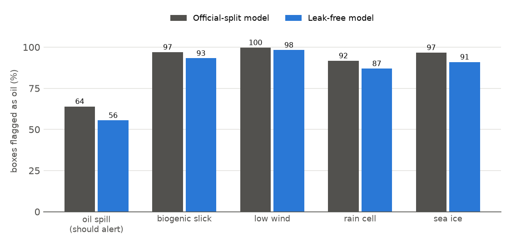

# M1 CBD-Net: external test on MDOD (look-alike false alerts)

**Data:** MDOD [N05], the OSF release: full Sentinel-1 scenes with **bounding boxes** in 5 classes (oil spill, biogenic slick, low wind, rain cell, sea ice). It has no pixel masks, so IoU and F1 cannot be computed. Instead we measure, for each box, how much of it the frozen model marks as oil.

**Protocol:** 400 boxes per class, sampled with seed 0; boxes smaller than 8 px are skipped. Each box is enlarged to at least 256 × 256 for context and predicted in 256 × 256 tiles, single pass (no TTA). The white land mask is excluded. *Coverage* = share of box pixels with p(oil) > 0.5. A box **alerts** if its coverage is at least 2 %.

## Per class

| Box class | Alert rate @2 %: official | Alert rate @2 %: leak-free | Alert rate @20 %: official | Alert rate @20 %: leak-free | Mean p(oil): official | Mean p(oil): leak-free |
|---|---|---|---|---|---|---|
| **oil spill** (should alert) | 64.0 | 55.5 | 42.0 | 38.5 | 0.27 | 0.25 |
| biogenic slick | 97.0 | 93.2 | 71.2 | 57.0 | 0.36 | 0.27 |
| low wind | 99.8 | 98.2 | 99.5 | 96.8 | 0.64 | 0.56 |
| rain cell | 91.8 | 87.0 | 65.0 | 54.5 | 0.34 | 0.29 |
| sea ice | 96.8 | 91.0 | 83.2 | 66.0 | 0.52 | 0.36 |

## Can the model rank oil above look-alikes? (AUC, oil boxes vs each look-alike class)

AUC is the chance that a random oil box gets a higher score than a random look-alike box. 0.5 = coin flip, 1.0 = perfect, **below 0.5 = look-alikes score higher than oil**.

| Oil vs | Official (box mean) | Leak-free (box mean) | Official (box peak) | Leak-free (box peak) |
|---|---|---|---|---|
| biogenic slick | 0.345 | 0.390 | 0.101 | 0.125 |
| low wind | 0.155 | 0.195 | 0.036 | 0.058 |
| rain cell | 0.379 | 0.404 | 0.207 | 0.238 |
| sea ice | 0.250 | 0.350 | 0.097 | 0.157 |
| all look-alikes | 0.282 | 0.335 | 0.110 | 0.144 |

## Findings
1. **Look-alikes trigger more alerts than real oil.** 87–100 % of look-alike boxes are flagged, but only 56–64 % of oil boxes. Low wind is the worst: almost every box is flagged, usually over half its area.
2. **AUC is below 0.5 for every look-alike class (0.16–0.40).** M1 has learned 'dark and smooth = oil', not the shape of a slick, so the most oil-like signal comes from large dark areas.
3. **The leak-free model is slightly less trigger-happy** (lower alert rates, AUC 0.34 vs 0.28), but it also flags less oil. Same pattern as on Peru; single seed.
4. **Caveat: scale.** MDOD scenes are about 10× coarser than SOS tiles, so many MDOD oil spills are thin streaks only a few pixels wide that the model misses. Part of the low oil alert rate is a resolution mismatch, not only a model weakness. The look-alike false alerts are real at any scale.
5. **Together with Peru** (86–90 % of look-alike pixels called oil), this is the evidence for C4 (wind- and look-alike-aware alerting): a detector trained on SOS cannot reject look-alikes by itself.

## Qualitative (`qualitative_official.png`, `qualitative_groupsplit.png`)
- Low-wind areas and the dark sides of rain cells and sea-ice edges light up as oil across most of the box.
- Biogenic slicks: the filaments are traced as oil.
- Thin oil streaks are often missed entirely (coverage 2 %); wider slicks are found.
