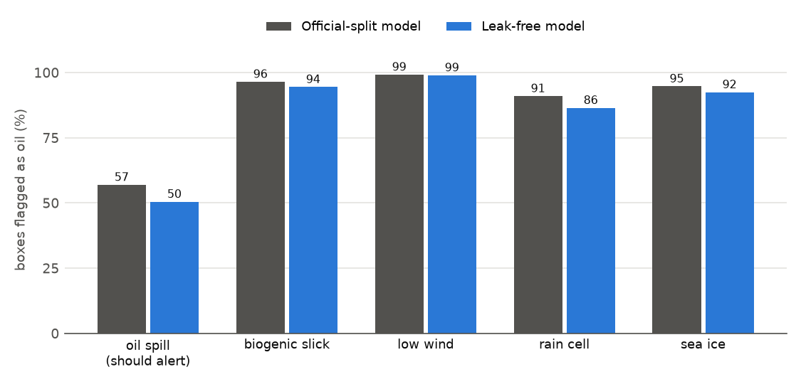

# M2 Improved DeepLabV3+: external test on MDOD (look-alike false alerts)

Same protocol as M1: 400 boxes per class, single pass, a box alerts if at least 2 % of it has p(oil) > 0.5.

| Box class | Alert @2 %: M2 official | Alert @2 %: M2 leak-free | M1 official | M1 leak-free |
|---|---|---|---|---|
| oil spill | 57.0 | 50.5 | 64.0 | 55.5 |
| biogenic slick | 96.5 | 94.5 | 97.0 | 93.2 |
| low wind | 99.2 | 99.0 | 99.8 | 98.2 |
| rain cell | 91.0 | 86.5 | 91.8 | 87.0 |
| sea ice | 94.8 | 92.5 | 96.8 | 91.0 |

| AUC oil vs | M2 official | M2 leak-free | M1 official | M1 leak-free |
|---|---|---|---|---|
| biogenic slick | 0.334 | 0.330 | 0.345 | 0.390 |
| low wind | 0.168 | 0.159 | 0.155 | 0.195 |
| rain cell | 0.387 | 0.373 | 0.379 | 0.404 |
| sea ice | 0.284 | 0.279 | 0.250 | 0.350 |
| all look-alikes | 0.293 | 0.286 | 0.282 | 0.335 |

## Findings
1. **Same failure as M1:** every look-alike class is flagged more often than real oil, and AUC is below 0.5.
2. M2 flags even fewer oil boxes than M1 (51–57 % vs 56–64 %); MDOD oil is often thin streaks (scale caveat as for M1).
